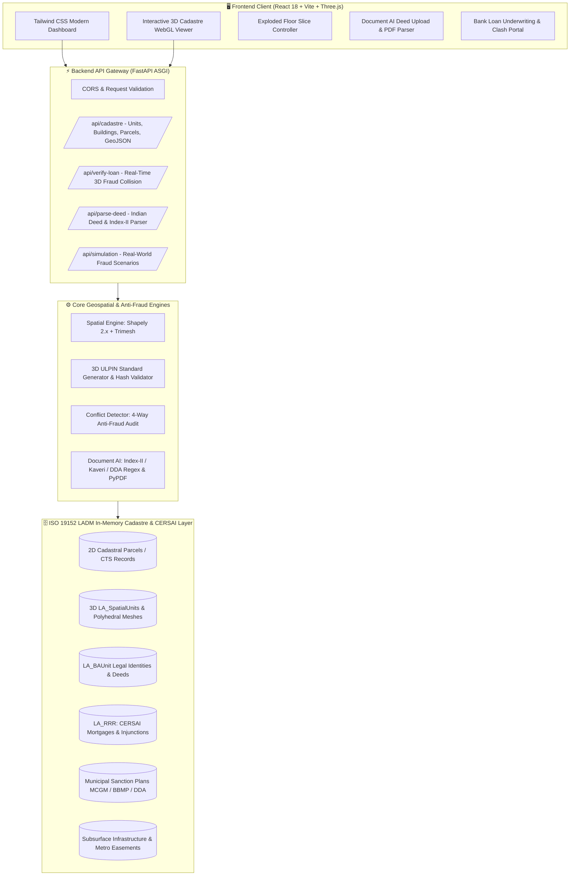

# 3D ULPIN: Volumetric Cadastre & Anti-Fraud Vertical Land Registry (SIH26011)

[](https://www.sih.gov.in/)
[](https://dolr.gov.in/)
[](https://www.iso.org/standard/51206.html)
[](https://fastapi.tiangolo.com)
[](https://threejs.org/)
[](https://www.docker.com/)
[](#test-suite--quality-assurance)

> **Department of Land Resources (DoLR), Ministry of Rural Development, Government of India**  
> *Transforming 2D Bhu-Aadhaar into a Multi-Dimensional 3D Volumetric Cadastre with Real-Time Multi-Bank Duplicate Mortgage Collision Detection & AI Deed Parser.*

---

## 🏛️ Executive Summary & Policy Alignment

Under the **Digital India Land Records Modernization Programme (DILRMP)**, India rolled out the 14-digit **ULPIN (Unique Land Parcel Identification Number) / Bhu-Aadhaar** to uniquely identify 2D land parcels. However, India's rapid urbanization and multi-story vertical high-rises create critical blind spots:
1. **Vertical Title Ambiguity**: 2D cadastre treats an entire 40-story skyscraper as a single coordinate point on the ground, making individual apartments, basements, and air rights legally invisible in spatial registries.
2. **Multi-Bank Mortgage Fraud (Double Financing)**: Fraudsters exploit paper deeds and non-spatial CERSAI registries to pledge the exact same physical flat to multiple banks (e.g., SBI, HDFC, ICICI) under slightly altered flat numbers or forged NOCs.
3. **Phantom Floors & Carpet Area Inflation**: Developers construct unauthorized floors above municipal sanction limits (e.g., BBMP, MCGM, DDA approved G+10 but built G+12) and sell unapproved space to unsuspecting buyers.
4. **Subsurface Encroachments**: Illegal underground basement excavations breach prohibited safety zones of Metro corridors, high-voltage utilities, and stormwater drains.

**3D ULPIN (SIH26011)** resolves these systemic challenges by introducing an end-to-end **ISO 19152 LADM-compliant 3D Volumetric Cadastre**, enabling automated 2D-to-3D algorithmic extrusion, AI deed parsing, real-time geometric intersection clash detection, and WebGL digital twins.

---

## 🚀 Key Features

- **🌐 Standardized Indian 3D-ULPIN**: Extends 2D Bhu-Aadhaar (`STATE-DIST-PIN`) with vertical spatial tokens:  
  `{2D_ULPIN}-{UNIT_TYPE}-{WING}-{FLOOR_Z}-{UNIT_ID}-{VOLUMETRIC_HASH}`  
  *Example:* `MH27-045-8912345-APT-W1-F04-U402-A7C9`
- **📐 ISO 19152 LADM Compliant Architecture**: Native implementation of `LA_SpatialUnit`, `LA_BAUnit`, `LA_Party`, and `LA_RRR` (Rights, Restrictions, Responsibilities).
- **⚡ Algorithmic 3D Volumetric Extrusion Engine**: Converts 2D Bhunaksha cadastral polygons and floor blueprints into watertight 3D polyhedral meshes using Shapely 2.x and Trimesh.
- **🛡️ Next-Gen 3D CERSAI Duplicate Mortgage Detector**: Computes exact 3D Boolean intersections in milliseconds ($V_{\text{overlap}} > 0$) to flag multi-bank double financing before loan disbursement.
- **📄 Indian Deed Document AI & OCR Engine**: Automated token extraction from Maharashtra Index-II, Karnataka Kaveri 2.0, Delhi Sub-Registrar Deeds, and standard Conveyance Deeds.
- **🏙️ Interactive 3D Digital Twin (Three.js WebGL)**: Exploded floor slice slider, real-time wireframe/solid toggle, raycasting inspector, volumetric clash visualizer, and 3D GeoJSON export.

---

## 🧮 Mathematical Formulation

### 1. Volumetric Prism Extrusion
Given a 2D closed cadastral polygon footprint $\mathcal{P} \subset \mathbb{R}^2$ with exterior vertex sequence:
$$\mathcal{P} = \left\{ (x_1, y_1), (x_2, y_2), \dots, (x_n, y_n), (x_1, y_1) \right\}$$

And vertical elevation bounds derived from municipal floor datum $Z_0$, floor level $k$, and slab height $h_{\text{floor}}$:
$$Z_{\text{base}} = Z_0 + \sum_{i=1}^{k-1} h_i, \quad Z_{\text{top}} = Z_{\text{base}} + h_k$$

The 3D Volumetric Spatial Unit $\mathcal{V} \subset \mathbb{R}^3$ is defined as the Minkowski sum / Cartesian product:
$$\mathcal{V} = \mathcal{P} \times [Z_{\text{base}}, Z_{\text{top}}] = \left\{ (x, y, z) \in \mathbb{R}^3 \mid (x, y) \in \mathcal{P}, \; Z_{\text{base}} \le z \le Z_{\text{top}} \right\}$$

The volumetric magnitude $V(\mathcal{V})$ is computed by:
$$V(\mathcal{V}) = \text{Area}(\mathcal{P}) \cdot (Z_{\text{top}} - Z_{\text{base}}) = \left( \frac{1}{2} \sum_{i=1}^{n} (x_i y_{i+1} - x_{i+1} y_i) \right) \cdot \Delta Z$$

### 2. 3D Volumetric Overlap & Clash Detection
For a candidate loan unit $\mathcal{V}_A = \mathcal{P}_A \times [Z_{\text{min}}^A, Z_{\text{max}}^A]$ and an existing encumbered unit $\mathcal{V}_B = \mathcal{P}_B \times [Z_{\text{min}}^B, Z_{\text{max}}^B]$:

1. **Vertical Elevation Intersection**:
   $$\Delta Z_{\text{overlap}} = \max\left(0, \; \min(Z_{\text{max}}^A, Z_{\text{max}}^B) - \max(Z_{\text{min}}^A, Z_{\text{min}}^B)\right)$$

2. **2D Planar Footprint Intersection**:
   $$\mathcal{P}_{\text{intersect}} = \mathcal{P}_A \cap \mathcal{P}_B$$

3. **Volumetric Collision Magnitude & Overlap Ratio**:
   $$V_{\text{overlap}} = \text{Area}(\mathcal{P}_{\text{intersect}}) \cdot \Delta Z_{\text{overlap}}$$
   $$\text{Overlap \%} = \left( \frac{V_{\text{overlap}}}{V(\mathcal{V}_A)} \right) \times 100\%$$

If $V_{\text{overlap}} > 0$ and Unit $B$ holds an active `RESTRICTION_MORTGAGE` (CERSAI registered), a **RED CRITICAL DUPLICATE MORTGAGE FRAUD** is triggered instantly.

### 3. Deterministic Volumetric Spatial Hash
To guarantee tamper-proof parcel identifiers, a 4-character hex hash is derived from the spatial bounding box $[x_{\min}, y_{\min}, z_{\min}, x_{\max}, y_{\max}, z_{\max}]$:
$$\mathcal{H}_{4} = \text{Truncate}_4 \left( \text{SHA256}\left( \text{FormatBBox}( \text{BBox}_{3D}, \text{precision}=2 ) \right) \right)$$

---

## 🏗️ System Architecture



---

## 🏙️ Real-World Indian Demo Scenarios

| Scenario | Location | Survey / CTS ID | Fraud Modus Operandi | 3D ULPIN Detection | Financial Impact Prevented |
| :--- | :--- | :--- | :--- | :--- | :--- |
| **1. Double Mortgage Clash** | Bandra West, Mumbai | CTS-1042 (Sea Breeze Towers) | Fraudster attempts ₹1.75 Cr loan from HDFC on Flat 402 with active SBI mortgage (CERSAI: `CERSAI-MH-2023-998821`). | 100% Volumetric Collision detected with active mortgage restriction. Decision: **REJECTED**. | **₹1.75 Crore** NPA prevented |
| **2. Phantom Floor Scam** | Whitefield, Bengaluru | Sy-84/2 (Silicon Heights) | Developer built 12 floors (39m height) when BBMP sanctioned only 10 floors (30m max height). Sells Flat 1204. | Top elevation exceeds BBMP sanction by **+9.0m**. Flagged: **PHANTOM_FLOOR**. | **₹1.85 Crore** buyer fraud prevented |
| **3. Subsurface Metro Clash** | Dwarka Sec-21, New Delhi | Khasra-412/1 (Metro View Plaza) | Developer illegally excavated Basement B3 (-11m depth) into DMRC Blue Line underground tunnel safety buffer zone. | 3D subterranean collision of **145 m³** in prohibited transit easement. | Transit infrastructure safety preserved |

---

## 🛠️ Technology Stack

- **Backend**: Python 3.11 / 3.12, FastAPI, Uvicorn, Pydantic v2, Shapely 2.x, Trimesh, Mapbox-Earcut, SciPy, NumPy, PyPDF.
- **Frontend**: React 18, Vite, Three.js, Lucide React, Tailwind CSS.
- **DevOps & Containers**: Multi-stage Dockerfiles, Docker Compose, Nginx Reverse Proxy with Gzip compression.
- **Standards**: ISO 19152 LADM (Land Administration Domain Model), OGC 3D GeoJSON, India Bhu-Aadhaar / ULPIN.

---

## 🚀 Quickstart Guide

### Prerequisites
- Python 3.11+
- Node.js 18+ and npm
- Git
- Docker & Docker Compose *(optional, for containerized run)*

---

### Option A: Local Development Setup

#### 1. Backend Setup (FastAPI)
```bash
cd backend

# Create and activate virtual environment
python3 -m venv venv
source venv/bin/activate

# Install dependencies
pip install --upgrade pip
pip install -r requirements.txt

# Run pytest test suite (20 tests)
pytest -v

# Start FastAPI ASGI server
uvicorn app.main:app --host 0.0.0.0 --port 8000 --reload
```
API Documentation will be live at: `http://localhost:8000/docs`

#### 2. Frontend Setup (React + Vite + Three.js)
```bash
cd ../frontend

# Install dependencies
npm install

# Build production bundle to verify
npm run build

# Start Vite development server
npm run dev
```
Open your browser at `http://localhost:5173` (or `http://localhost:3000`).

---

### Option B: Docker Compose Deployment

To orchestrate the full stack in production-grade isolated containers:

```bash
# From project root:
docker-compose up --build
```

- **Frontend Application & 3D Viewer**: `http://localhost:3000` (or `http://localhost:5173`)
- **FastAPI Backend & Interactive Swagger Docs**: `http://localhost:8000/docs`
- **Health Check**: `http://localhost:8000/api/health`

---

## 📡 Core API Reference

| Endpoint | Method | Description |
| :--- | :--- | :--- |
| `/api/cadastre/parcels` | `GET` | Retrieve all 2D base cadastral parcels registered in Bhu-Aadhaar. |
| `/api/cadastre/parcel/{ulpin_2d}` | `GET` | Get parcel details and municipal sanction plan for a 2D ULPIN. |
| `/api/cadastre/buildings` | `GET` | Retrieve municipal building approval sanction plans (MCGM, BBMP, DDA). |
| `/api/cadastre/units` | `GET` | List all 3D spatial units with optional `building_id`, `floor_number`, and `status_filter`. |
| `/api/cadastre/unit/{ulpin_3d}` | `GET` | Retrieve full 3D spatial unit with WebGL mesh, legal BAUnit, and active CERSAI RRR records. |
| `/api/cadastre/export/geojson` | `GET` | Export 3D Cadastral units as standard 3D GeoJSON FeatureCollection (Polygon Z). |
| `/api/verify-loan` | `POST` | Execute real-time 3D spatial collision and multi-bank mortgage verification for loan underwriting. |
| `/api/parse-deed` | `POST` | Parse Indian PDF deed / Index-II document and extract 3D cadastre coordinates. |
| `/api/parse-deed/json` | `POST` | Parse raw deed / Index-II text directly and generate 3D spatial unit preview. |
| `/api/simulation/scenarios` | `GET` | List pre-configured Indian fraud scenarios (Mumbai, Bengaluru, Delhi). |
| `/api/simulation/run/{scenario_id}`| `POST` | Run live simulation with 3D mesh clash geometry and financial impact report. |
| `/api/health` | `GET` | Healthcheck returning count of loaded parcels, buildings, and spatial units. |

---

## 🧪 Test Suite & Quality Assurance

The backend includes a comprehensive pytest suite covering ISO 19152 data structures, 3D polygon extrusion, spatial collisions, document AI, and REST APIs:

```bash
cd backend
pytest -v
```

```text
============================= test session starts ==============================
tests/test_cadastre.py::test_floor_code_formatting PASSED                [  5%]
tests/test_cadastre.py::test_volumetric_hash_generation PASSED           [ 10%]
tests/test_cadastre.py::test_3d_ulpin_generation_and_parsing PASSED      [ 15%]
tests/test_cadastre.py::test_2d_to_3d_mesh_extrusion PASSED              [ 20%]
tests/test_cadastre.py::test_volumetric_overlap_calculation PASSED       [ 25%]
tests/test_cadastre.py::test_floor_subdivision_and_geojson_export PASSED [ 30%]
tests/test_cadastre.py::test_duplicate_mortgage_clash_detection PASSED   [ 35%]
tests/test_cadastre.py::test_phantom_floor_detection PASSED              [ 40%]
tests/test_cadastre.py::test_carpet_inflation_detection PASSED           [ 45%]
tests/test_cadastre.py::test_subsurface_metro_easement_clash PASSED      [ 50%]
tests/test_cadastre.py::test_document_ai_index_ii_parsing PASSED         [ 55%]
tests/test_cadastre.py::test_api_health PASSED                           [ 60%]
tests/test_cadastre.py::test_api_get_parcels_and_buildings PASSED        [ 65%]
tests/test_cadastre.py::test_api_get_units_with_filters PASSED           [ 70%]
tests/test_cadastre.py::test_api_verify_loan_fraud_clash PASSED          [ 75%]
tests/test_cadastre.py::test_api_parse_deed_json PASSED                  [ 80%]
tests/test_cadastre.py::test_api_simulation_scenarios PASSED             [ 85%]
tests/test_cadastre.py::test_api_parse_deed_pdf_upload PASSED            [ 90%]
tests/test_cadastre.py::test_api_single_unit_by_ulpin PASSED             [ 95%]
tests/test_cadastre.py::test_api_register_new_spatial_unit PASSED        [100%]
======================== 20 passed, 1 warning in 1.23s =========================
```

---

## 📜 Standards & Compliance

- **ISO 19152:2012 / 2024 (LADM)**: Geographic information — Land Administration Domain Model
- **DILRMP (DoLR)**: Digital India Land Records Modernization Programme
- **OGC**: Open Geospatial Consortium Standards (3D GeoJSON / CityGML conventions)
- **CERSAI**: Central Registry of Securitisation Asset Reconstruction and Security Interest of India

---

## 👥 Authors & Acknowledgments

Developed for **Smart India Hackathon (SIH26011)**  
Problem Statement: **3D ULPIN Generation & Vertical Property Mapping System**  
Organization: **Ministry of Rural Development & Department of Land Resources (DoLR)**
