# 3D ULPIN

Prototype for 3D land parcel visualization and spatial conflict detection.

## What it does

- Extrudes 2D parcel footprints into 3D volumes.
- Checks volumetric overlaps and displays conflicts in a 3D viewer.
- Includes a simulated drone mapping and document review workflow.

## Getting started

For local development, start the FastAPI backend from `backend/` using its requirements file, then run `npm install` and `npm run dev` in `frontend/`. See the backend and frontend READMEs for detailed setup.

## Security

Keep credentials in local environment files. The example files contain placeholders only. Rotate any credential previously used in a local deployment before publishing or redeploying.

## License

The project code is licensed under AGPL-3.0-only. See [LICENSE](LICENSE).
